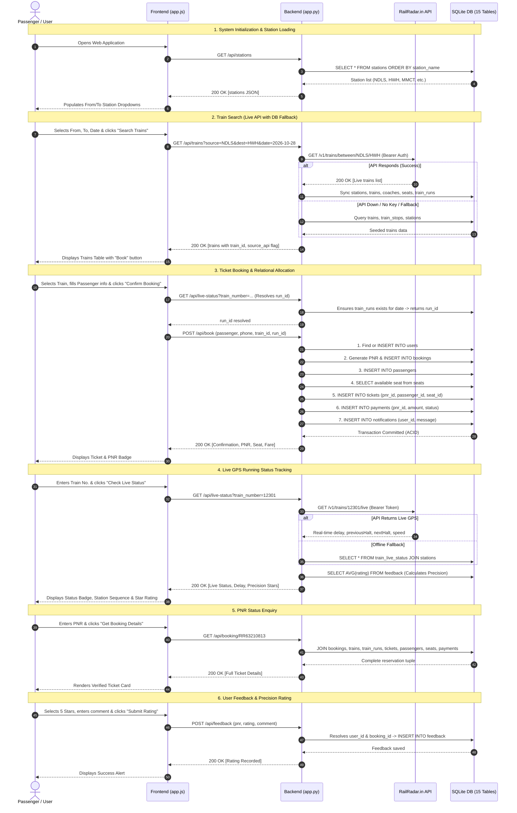

# RailReserve - End-to-End Application Workflow & 15-Table Access Lifecycle

**Course:** Database Management Systems (DBMS)  
**Project:** RailReserve (Railway Reservation & Live Tracking System)  
**Database:** SQLite 3 (`database.sqlite`)  
**Backend:** Python Flask (`app.py`)  
**Frontend:** Vanilla JS (`static/app.js`), HTML5, CSS3  
**External API:** RailRadar.in REST API  

---

## 1. High-Level System Architecture & Flowchart



---

## 2. Exhaustive Step-by-Step Flow & Table Access Matrix

Every single user interaction in the application touches specific database tables in a strictly defined relational order. Below is the detailed breakdown:

---

### STEP 0: User Registration, Authentication & Session (Local SQLite)

The system includes local DBMS authentication without external/cloud authentication services:
- **User Action:** User registers a new account or logs in with existing credentials (`demo@rail.in` / `demo123`).
- **HTTP Endpoints:**
  - `POST /api/auth/register` (creates user in `users` table with hashed password, dispatches welcome notification in `notifications`).
  - `POST /api/auth/login` (verifies credentials against `users` table and establishes Flask session cookie).
  - `GET /api/auth/me` (checks current session against `users` table).
  - `POST /api/auth/logout` (destroys active session).
  - `GET /api/my-bookings` (queries relational bookings and tickets belonging to `user_id`).

#### Database Queries Executed:
```sql
-- Registration: Check if user exists & insert new record
SELECT user_id FROM users WHERE LOWER(email) = ?;
INSERT INTO users (name, email, phone, password) VALUES (?, ?, ?, ?);
INSERT INTO notifications (user_id, message, type) VALUES (?, ?, 'account');

-- Login: Authenticate against local users table
SELECT user_id, name, email, phone, password, created_at 
FROM users 
WHERE LOWER(email) = ? OR phone = ?;

-- My Bookings: User-scoped multi-table relational join
SELECT b.booking_id, b.pnr, b.booking_status, b.booked_at,
       t.train_name, t.train_number, tr.run_date,
       s1.station_name AS src_name, s2.station_name AS dst_name,
       p.name AS passenger_name, p.age, p.gender,
       st.seat_number, tk.fare, pay.payment_status
FROM bookings b
JOIN trains t ON b.train_id = t.train_id
JOIN train_runs tr ON b.run_id = tr.run_id
LEFT JOIN stations s1 ON t.source_station_id = s1.station_id
LEFT JOIN stations s2 ON t.destination_station_id = s2.station_id
LEFT JOIN tickets tk ON b.booking_id = tk.pnr_id
LEFT JOIN passengers p ON tk.passenger_id = p.passenger_id
LEFT JOIN seats st ON tk.seat_id = st.seat_id
LEFT JOIN payments pay ON b.booking_id = pay.pnr_id
WHERE b.user_id = ?
ORDER BY b.booking_id DESC;
```

#### Tables Accessed:
| Table Name | Operation | Purpose |
|---|:---:|---|
| **`users`** | **INSERT / SELECT** | Persists user credentials and profile for local session authentication. |
| **`notifications`** | **INSERT** | Stores account registration welcome alert. |
| **`bookings`**, **`tickets`**, **`passengers`**, **`trains`**, **`payments`** | **READ (`SELECT JOIN`)** | Fetches user's personal booking history via `user_id` foreign key. |

---

### STEP 1: Application Initialization & Station Population

When the user opens the application (`http://127.0.0.1:5000/`):
- **User Action:** Browser loads page.
- **Frontend Trigger:** `document.addEventListener("DOMContentLoaded", ...)` triggers `loadStations()`.
- **HTTP Request:** `GET /api/stations`
- **Backend Function in `app.py`:** `get_stations()`

#### Database Query Executed:
```sql
SELECT station_id, station_name, station_code, city, state 
FROM stations 
ORDER BY station_name ASC;
```

#### Tables Accessed:
| Table Name | Operation | Purpose |
|---|:---:|---|
| **`stations`** | **READ (`SELECT`)** | Retrieves master list of all stations with station codes (e.g. `NDLS`, `HWH`, `MMCT`). |

#### Output:
JSON array of station objects is returned and injected into `#bsrc` (From Station) and `#bdest` (To Station) HTML dropdowns.

---

### STEP 2: Train Search & Live API / Database Synchronization

- **User Action:** User selects Source (`NDLS`), Destination (`HWH`), Journey Date (`2026-10-28`), and clicks **"Search Trains"**.
- **Frontend Trigger:** `searchTrains()` in `static/app.js`.
- **HTTP Request:** `GET /api/trains?source=NDLS&dest=HWH&date=2026-10-28`
- **Backend Function in `app.py`:** `search_trains()`

#### Execution Flow & Logic:
1. **Primary Branch (RailRadar.in Live REST API):**
   - Calls `GET https://api.railradar.in/v1/trains/between/NDLS/HWH` with `Authorization: Bearer <API_KEY>`.
   - When API returns available trains, backend calls `sync_train_to_db(conn, train_data, journey_date)`.
   - **Why this is critical for DBMS:** If a train comes from the live web API, it must exist inside SQLite so foreign keys (coaches, seats, runs, bookings) can point to it!

#### Database Queries Executed During Synchronization:
```sql
-- 1. Ensure Origin & Destination Stations exist in SQLite
INSERT OR IGNORE INTO stations (station_name, station_code, city, state) VALUES (?, ?, ?, 'India');
SELECT station_id FROM stations WHERE station_code = ?;

-- 2. Ensure Train master record exists
SELECT train_id FROM trains WHERE train_number = ?;
INSERT INTO trains (train_name, train_number, source_station_id, destination_station_id, running_days, total_seats) 
VALUES (?, ?, ?, ?, ?, ?);

-- 3. Ensure Coach exists
SELECT coach_id FROM coaches WHERE train_id = ?;
INSERT INTO coaches (train_id, coach_number, total_seats) VALUES (?, 'A1', 72);

-- 4. Ensure Seat Inventory is generated
SELECT COUNT(*) FROM seats WHERE train_id = ?;
SELECT class_id, fare_per_km FROM coach_classes;
INSERT INTO seats (train_id, coach_id, class_id, seat_number, berth_type, fare_per_km) VALUES (?, ?, ?, ?, 'Seat', ?);

-- 5. Ensure Train Run entry exists for the requested journey date
SELECT run_id FROM train_runs WHERE train_id = ? AND (run_date = ? OR journey_date = ?);
INSERT INTO train_runs (train_id, run_date, journey_date, source_station, destination_station, ncr_status) VALUES (?, ?, ?, ?, ?, 'Normal');
```

2. **Secondary Branch (Local SQLite Database Fallback):**
   - Triggered if API key is not present, network fails, or RailRadar returns no trains.
   - Searches local SQLite database using direct match and intermediate station stops.

```sql
-- Direct Origin to Destination Match
SELECT t.train_id, t.train_name, t.train_number, t.running_days, t.total_seats,
       s1.station_name AS source_name, s2.station_name AS dest_name
FROM trains t
JOIN stations s1 ON t.source_station_id = s1.station_id
JOIN stations s2 ON t.destination_station_id = s2.station_id
WHERE (s1.station_code = ? AND s2.station_code = ?);

-- Intermediate Stops Match
SELECT DISTINCT t.train_id, t.train_name, t.train_number, t.running_days, t.total_seats,
       s1.station_name AS source_name, s2.station_name AS dest_name
FROM trains t
JOIN train_stops st1 ON t.train_id = st1.train_id
JOIN stations s1 ON st1.station_id = s1.station_id
JOIN train_stops st2 ON t.train_id = st2.train_id
JOIN stations s2 ON st2.station_id = s2.station_id
WHERE s1.station_code = ? AND s2.station_code = ? AND st1.sequence_no < st2.sequence_no;
```

#### Tables Accessed in Step 2:
| Table Name | Operation | Purpose |
|---|:---:|---|
| **`stations`** | **READ / INSERT** | Validates source and destination station records. |
| **`trains`** | **READ / INSERT** | Master train catalogue matching the requested route. |
| **`train_stops`** | **READ** | Queries multi-hop routing when intermediate halts exist. |
| **`coach_classes`**| **READ** | Provides class definitions (`SL`, `3A`, `2A`, `CC`) and fare rates. |
| **`coaches`** | **READ / INSERT** | Links physical coaches (`A1`) to the train. |
| **`seats`** | **READ / INSERT** | Generates seat numbers `1` through `72` for passenger allocation. |
| **`train_runs`** | **READ / INSERT** | Registers the operational run for the specific calendar date. |

---

### STEP 3: Ticket Booking & Relational Multi-Table Insertion

- **User Action:** User selects a train, fills in Passenger Name, Age, Gender, Phone, Email, ID Proof No., and clicks **"Confirm & Book Ticket"**.
- **Frontend Trigger:** `bookTicket(event)` in `static/app.js`.
- **HTTP Request:** `POST /api/book` with JSON body.
- **Backend Function in `app.py`:** `book_ticket()`

#### Relational Transaction Workflow (ACID compliant):

#### 1. Table `users`: User Profile Resolution
```sql
SELECT user_id FROM users WHERE email = ? OR phone = ?;
-- If user does not exist:
INSERT INTO users (name, email, phone, password) VALUES (?, ?, ?, 'demo123');
```
*Captures or registers the person executing the booking transaction.*

#### 2. Table `bookings`: Master Booking Header & PNR
- Generates a unique 10-character PNR (e.g. `RR49895558`).
```sql
INSERT INTO bookings (user_id, train_id, run_id, pnr, booking_status) 
VALUES (?, ?, ?, ?, 'Confirmed');
```
*Creates parent booking record referenced by tickets and payments.*

#### 3. Table `passengers`: Passenger Demographic Record
```sql
INSERT INTO passengers (user_id, name, age, gender, id_proof_type, id_proof_no) 
VALUES (?, ?, ?, ?, ?, ?);
```
*Separates passenger details from account owner (1:N relationship).*

#### 4. Tables `seats` & `tickets`: Dynamic Seat Allocation & Fare Calculation
- Prevents double-booking by querying already reserved seats on that specific `run_id`:
```sql
SELECT seat_id FROM tickets 
WHERE run_id = ? AND (cancellation IS NULL OR cancellation = 'Active');

SELECT seat_id, seat_number, fare_per_km FROM seats WHERE train_id = ?;
```
- Allocates the first available seat (e.g. Seat `1`).
- Inserts individual passenger ticket record:
```sql
INSERT INTO tickets (pnr_id, passenger_id, run_id, seat_id, fare, cancellation) 
VALUES (?, ?, ?, ?, ?, 'Active');
```

#### 5. Table `payments`: Financial Audit Record
- Generates transaction reference (e.g. `TXN9832481023`):
```sql
INSERT INTO payments (pnr_id, amount, payment_mode, payment_status, transaction_ref, paid_by) 
VALUES (?, ?, 'UPI/Demo', 'Paid', ?, ?);
```

#### 6. Table `notifications`: User Alert Dispatch
```sql
INSERT INTO notifications (user_id, message, type) 
VALUES (?, 'Booking Confirmed! PNR: RR49895558, Seat: 1, Fare: Rs.300.00.', 'booking');
```

#### 7. Commit Transaction
```python
conn.commit()
```

#### Tables Accessed in Step 3:
| Table Name | Operation | Purpose |
|---|:---:|---|
| **`users`** | **READ / INSERT** | Identifies or registers user account. |
| **`bookings`** | **INSERT** | Creates master booking row with unique PNR. |
| **`passengers`**| **INSERT** | Inserts passenger demographic & ID details. |
| **`coaches`** | **READ** | Verifies coach assignment. |
| **`seats`** | **READ / INSERT** | Assigns next available non-conflicting seat. |
| **`tickets`** | **READ / INSERT** | Creates ticket record binding PNR, passenger, seat, and run. |
| **`payments`** | **INSERT** | Logs payment confirmation with transaction reference. |
| **`notifications`**| **INSERT** | Generates system alert message for the user. |

---

### STEP 4: Live Train Status Tracking & GPS Telemetry

- **User Action:** User navigates to **"Live Status"** tab, enters train number (e.g. `12301`), and clicks **"Check Live Status"**.
- **Frontend Trigger:** `checkStatus()` in `static/app.js`.
- **HTTP Request:** `GET /api/live-status?train_number=12301`
- **Backend Function in `app.py`:** `live_status()`

#### Execution Flow:
1. Queries RailRadar REST API:
   - `GET https://api.railradar.in/v1/trains/12301/live` with Bearer Token.
   - Extracts real delay minutes, current coordinates / halt station, next station, and status string.
2. If API fails, falls back to `train_live_status` table:
```sql
SELECT tls.*,
       s_curr.station_name AS current_name,
       s_next.station_name AS next_name,
       s_last.station_name AS last_name
FROM train_live_status tls
LEFT JOIN stations s_curr ON tls.current_station_id = s_curr.station_id
LEFT JOIN stations s_next ON tls.next_station_id = s_next.station_id
LEFT JOIN stations s_last ON tls.last_station_id = s_last.station_id
WHERE tls.train_id = ?
ORDER BY tls.last_updated_at DESC LIMIT 1;
```
3. Calculates Precision Rating by joining with `feedback`:
```sql
SELECT AVG(f.rating) AS avg_rating
FROM feedback f
JOIN bookings b ON f.pnr_id = b.booking_id
WHERE b.train_id = ?;
```

#### Tables Accessed in Step 4:
| Table Name | Operation | Purpose |
|---|:---:|---|
| **`trains`** | **READ** | Finds train ID by train number. |
| **`train_runs`** | **READ / INSERT** | Resolves active run schedule ID. |
| **`train_live_status`**| **READ / INSERT** | Retrieves delay, current position, and next station. |
| **`stations`** | **READ** | Resolves foreign key station IDs to human-readable station names. |
| **`feedback`** | **READ (`AVG`)** | Computes average precision score from past passenger ratings. |

---

### STEP 5: PNR Status Enquiry

- **User Action:** User clicks **"PNR Enquiry"**, enters PNR number (e.g. `RR49895558`), and clicks **"Get Booking Details"**.
- **Frontend Trigger:** `checkPnr()` in `static/app.js`.
- **HTTP Request:** `GET /api/booking/RR49895558`
- **Backend Function in `app.py`:** `get_booking(pnr)`

#### Database Query Executed (Multi-Table Relational JOIN):
```sql
SELECT b.booking_id, b.pnr, b.booking_status, b.booked_at,
       t.train_name, t.train_number, tr.run_date,
       s1.station_name AS src_name, s2.station_name AS dst_name,
       p.name AS passenger_name, p.age, p.gender,
       st.seat_number, tk.fare, pay.payment_status
FROM bookings b
JOIN trains t ON b.train_id = t.train_id
JOIN train_runs tr ON b.run_id = tr.run_id
LEFT JOIN stations s1 ON t.source_station_id = s1.station_id
LEFT JOIN stations s2 ON t.destination_station_id = s2.station_id
LEFT JOIN tickets tk ON b.booking_id = tk.pnr_id
LEFT JOIN passengers p ON tk.passenger_id = p.passenger_id
LEFT JOIN seats st ON tk.seat_id = st.seat_id
LEFT JOIN payments pay ON b.booking_id = pay.pnr_id
WHERE b.pnr = ?;
```

#### Tables Accessed in Step 5:
| Table Name | Operation | Purpose |
|---|:---:|---|
| **`bookings`** | **READ** | Finds booking header matching PNR. |
| **`trains`** | **READ (`JOIN`)** | Fetches train name and train number. |
| **`train_runs`** | **READ (`JOIN`)** | Fetches scheduled journey date. |
| **`stations`** | **READ (`JOIN`)** | Fetches origin and destination names. |
| **`tickets`** | **READ (`JOIN`)** | Links ticket fare and cancellation status. |
| **`passengers`**| **READ (`JOIN`)** | Fetches passenger name, age, and gender. |
| **`seats`** | **READ (`JOIN`)** | Fetches assigned seat number (e.g. `1`). |
| **`payments`** | **READ (`JOIN`)** | Fetches payment status (`Paid`). |

---

### STEP 6: Passenger Feedback & Train Precision Rating System

- **User Action:** Passenger rates their journey (1 to 5 stars), selects a category (`Punctuality & Precision`, `Cleanliness & Hygiene`, `Seat Comfort`, `Food & Catering`, `Staff Behavior`, or `Overall Experience`), writes an optional comment, and clicks **"Submit Journey Rating"**. Can be submitted via the universal modal from **My Bookings**, **PNR Enquiry**, **Live Status**, or the top navigation.
- **Frontend Trigger:** `openRating()` / `submitFeedbackForm()` in `static/app.js`.
- **HTTP Requests:**
  - `POST /api/feedback` (records or updates feedback, recalculates train average rating)
  - `GET /api/feedback/<pnr>` (fetches passenger's existing rating for that ticket)
  - `GET /api/trains/<train_id>/feedback` (fetches recent passenger reviews for that train)
- **Backend Functions in `app.py`:** `submit_feedback()`, `get_pnr_feedback()`, `get_train_feedback()`, `get_train_rating_info()`

#### Relational Database Queries Executed:
```sql
-- 1. Check if feedback already exists for this booking/PNR
SELECT feedback_id FROM feedback WHERE pnr_id = ?;

-- 2. Upsert rating (INSERT or UPDATE)
-- If new review:
INSERT INTO feedback (pnr_id, user_id, rating, feedback_type, description, created_at)
VALUES (?, ?, ?, ?, ?, datetime('now'));
-- If existing review:
UPDATE feedback
SET rating = ?, feedback_type = ?, description = ?, created_at = datetime('now')
WHERE feedback_id = ?;

-- 3. Immediate Relational Aggregation (recalculates train precision rating):
SELECT AVG(f.rating) AS avg_rating, COUNT(f.feedback_id) AS total_reviews
FROM feedback f
JOIN bookings b ON f.pnr_id = b.booking_id
WHERE b.train_id = ?;

-- 4. Dispatch notification to user's profile:
INSERT INTO notifications (user_id, message, type)
VALUES (?, ?, 'feedback');
```

#### How Feedback Propagates Across the Relational System:
1. **Train Search (`/api/trains`)**: Every train displays its real-time rating `★ avg_rating (N reviews)` in the search results table.
2. **Live Train Status (`/api/live-status`)**: Real-time precision rating is driven by the aggregated SQLite passenger feedback (`AVG(f.rating)`), and recent passenger comments are dynamically rendered.
3. **My Bookings (`/api/my-bookings`)**: Highlights whether the passenger has completed feedback (`★ 5/5 Rated`) with an **"Edit Review"** option, or prompts them with a **"⭐ Rate Journey"** button.
4. **PNR Enquiry (`/api/booking/<pnr>`)**: Displays verified journey feedback and passenger review cards.

#### Tables Accessed in Step 6:
| Table Name | Operation | Purpose |
|---|:---:|---|
| **`bookings`** | **READ** | Validates PNR existence and resolves `train_id` and `user_id`. |
| **`users`** | **READ** | Attributes feedback to the authenticated passenger. |
| **`feedback`** | **INSERT / UPDATE / SELECT** | Persists 1-5 star review with `CHECK (rating >= 1 AND rating <= 5)`. |
| **`notifications`** | **INSERT** | Notifies user that their rating updated the train's precision score. |

---

## 3. Complete 15-Table Access Checklist

| # | Table Name | Where Accessed in Code | Operations Performed |
|---|---|---|:---:|
| 1 | **`users`** | `/api/book`, `/api/feedback` | `SELECT`, `INSERT` |
| 2 | **`stations`** | `/api/stations`, `/api/trains`, `/api/live-status`, `/api/booking/<pnr>` | `SELECT`, `INSERT` |
| 3 | **`trains`** | `/api/trains`, `/api/book`, `/api/live-status`, `/api/booking/<pnr>` | `SELECT`, `INSERT` |
| 4 | **`train_stops`** | `/api/trains` (intermediate halts query) | `SELECT`, `INSERT` |
| 5 | **`coach_classes`**| `ensure_coach_and_seats()` | `SELECT`, `INSERT` |
| 6 | **`coaches`** | `ensure_coach_and_seats()`, `/api/book` | `SELECT`, `INSERT` |
| 7 | **`seats`** | `ensure_coach_and_seats()`, `/api/book`, `/api/booking/<pnr>` | `SELECT`, `INSERT` |
| 8 | **`train_runs`** | `ensure_run_exists()`, `/api/trains`, `/api/book`, `/api/live-status` | `SELECT`, `INSERT` |
| 9 | **`bookings`** | `/api/book`, `/api/booking/<pnr>`, `/api/feedback`, `/api/live-status` | `SELECT`, `INSERT` |
| 10 | **`passengers`** | `/api/book`, `/api/booking/<pnr>` | `SELECT`, `INSERT` |
| 11 | **`tickets`** | `/api/book`, `/api/booking/<pnr>` | `SELECT`, `INSERT` |
| 12 | **`payments`** | `/api/book`, `/api/booking/<pnr>` | `SELECT`, `INSERT` |
| 13 | **`feedback`** | `/api/feedback`, `/api/live-status` (`AVG(rating)`) | `SELECT`, `INSERT` |
| 14 | **`train_live_status`**| `ensure_run_exists()`, `/api/live-status` | `SELECT`, `INSERT` |
| 15 | **`notifications`**| `/api/book` | `INSERT` |

---

## 4. Key Highlights for DBMS Lab Viva / Evaluation

When demonstrating this project to your professor, you can highlight these specific relational DBMS principles:

1. **Foreign Key Enforcement (`PRAGMA foreign_keys = ON;`):**
   - No orphan tickets can exist without a booking (`pnr_id`).
   - Every booking references an authentic user, train, and run instance.
2. **ACID Transaction Handling:**
   - Booking executes user creation, PNR generation, seat assignment, ticket creation, payment record, and notification within an atomic transaction. If any step fails, changes are rolled back.
3. **No Double-Booking Concurrency Principle:**
   - `/api/book` checks existing tickets for that specific `run_id` before assigning a seat ID, ensuring zero seat overlaps.
4. **Third Normal Form (3NF / BCNF):**
   - Intermediate station stops are normalized into `train_stops` instead of storing arrays inside `trains`.
   - Fares per class are separated into `coach_classes`.
5. **Hybrid Architecture (Web API + Relational Fallback):**
   - High-availability design: Uses live RailRadar API when connected, and gracefully falls back to local seeded SQLite database with identical schema mappings.
