# Railway Reservation System - Entity Relationship (ER) Diagram & Relational Schema Documentation

**Course / Lab:** Database Management Systems (DBMS) Laboratory  
**Project:** RailReserve - Railway Reservation & Live Tracking System  
**Database Engine:** SQLite 3 (Foreign Keys Enabled)  
**Total Entities / Tables:** 15  

---

## 1. Complete Entity-Relationship (ER) Diagram

The following ER diagram captures all **15 entities**, their attributes, data types, primary keys (`PK`), foreign keys (`FK`), and the exact relationship cardinalities as defined in `schema.sql`.

```mermaid
erDiagram
    USERS ||--o{ BOOKINGS : "places (1:N)"
    USERS ||--o{ PASSENGERS : "manages (1:N)"
    USERS ||--o{ FEEDBACK : "submits (1:N)"
    USERS ||--o{ NOTIFICATIONS : "receives (1:N)"

    STATIONS ||--o{ TRAINS : "origin_of (1:N)"
    STATIONS ||--o{ TRAINS : "destination_of (1:N)"
    STATIONS ||--o{ TRAIN_STOPS : "halts_at (1:N)"
    STATIONS ||--o{ TRAIN_LIVE_STATUS : "current_loc (1:N)"
    STATIONS ||--o{ TRAIN_LIVE_STATUS : "next_loc (1:N)"
    STATIONS ||--o{ TRAIN_LIVE_STATUS : "last_loc (1:N)"

    TRAINS ||--o{ TRAIN_STOPS : "has_stops (1:N)"
    TRAINS ||--o{ COACHES : "composed_of (1:N)"
    TRAINS ||--o{ SEATS : "contains_seats (1:N)"
    TRAINS ||--o{ TRAIN_RUNS : "scheduled_as (1:N)"
    TRAINS ||--o{ BOOKINGS : "booked_for (1:N)"
    TRAINS ||--o{ TRAIN_LIVE_STATUS : "tracked_in (1:N)"

    COACH_CLASSES ||--o{ SEATS : "categorizes (1:N)"
    COACHES ||--o{ SEATS : "accommodates (1:N)"

    TRAIN_RUNS ||--o{ BOOKINGS : "operates_run (1:N)"
    TRAIN_RUNS ||--o{ TICKETS : "valid_for_run (1:N)"
    TRAIN_RUNS ||--o{ TRAIN_LIVE_STATUS : "monitored_run (1:N)"

    BOOKINGS ||--o{ TICKETS : "issues (1:N)"
    BOOKINGS ||--o{ PAYMENTS : "paid_via (1:N)"
    BOOKINGS ||--o{ FEEDBACK : "reviewed_in (1:N)"

    PASSENGERS ||--o{ TICKETS : "assigned_to (1:N)"
    SEATS ||--o{ TICKETS : "allocated_to (1:N)"

    USERS {
        INTEGER user_id PK "AUTOINCREMENT"
        VARCHAR name "NOT NULL"
        VARCHAR email "UNIQUE, NOT NULL"
        VARCHAR phone "VARCHAR(20)"
        VARCHAR password "NOT NULL"
        TIMESTAMP created_at "DEFAULT CURRENT_TIMESTAMP"
    }

    STATIONS {
        INTEGER station_id PK "AUTOINCREMENT"
        VARCHAR station_name "NOT NULL"
        VARCHAR station_code "UNIQUE, NOT NULL"
        VARCHAR city "VARCHAR(100)"
        VARCHAR state "VARCHAR(100)"
    }

    TRAINS {
        INTEGER train_id PK "AUTOINCREMENT"
        VARCHAR train_name "NOT NULL"
        VARCHAR train_number "UNIQUE, NOT NULL"
        INTEGER source_station_id FK "REFERENCES stations(station_id)"
        INTEGER destination_station_id FK "REFERENCES stations(station_id)"
        VARCHAR running_days "VARCHAR(100)"
        INTEGER total_seats "DEFAULT 100"
    }

    TRAIN_STOPS {
        INTEGER stop_id PK "AUTOINCREMENT"
        INTEGER train_id FK "REFERENCES trains(train_id)"
        INTEGER station_id FK "REFERENCES stations(station_id)"
        INTEGER sequence_no "NOT NULL"
        TIME arrival_time "TIME"
        TIME departure_time "TIME"
        INTEGER halt_duration "INTEGER"
        INTEGER day_offset "DEFAULT 0"
        INTEGER distance_from_source "INTEGER"
    }

    COACH_CLASSES {
        INTEGER class_id PK "AUTOINCREMENT"
        VARCHAR class_code "NOT NULL"
        VARCHAR class_name "NOT NULL"
        NUMERIC fare_per_km "NUMERIC(6,2)"
    }

    COACHES {
        INTEGER coach_id PK "AUTOINCREMENT"
        INTEGER train_id FK "REFERENCES trains(train_id)"
        VARCHAR coach_number "VARCHAR(20)"
        INTEGER total_seats "DEFAULT 72"
    }

    SEATS {
        INTEGER seat_id PK "AUTOINCREMENT"
        INTEGER train_id FK "REFERENCES trains(train_id)"
        INTEGER coach_id FK "REFERENCES coaches(coach_id)"
        INTEGER class_id FK "REFERENCES coach_classes(class_id)"
        VARCHAR seat_number "NOT NULL"
        VARCHAR berth_type "DEFAULT 'Seat'"
        NUMERIC fare_per_km "NUMERIC(6,2)"
    }

    TRAIN_RUNS {
        INTEGER run_id PK "AUTOINCREMENT"
        INTEGER train_id FK "REFERENCES trains(train_id)"
        DATE run_date "NOT NULL"
        DATE journey_date "DATE"
        VARCHAR source_station "VARCHAR(100)"
        VARCHAR destination_station "VARCHAR(100)"
        VARCHAR ncr_status "VARCHAR(50)"
    }

    BOOKINGS {
        INTEGER booking_id PK "AUTOINCREMENT"
        INTEGER user_id FK "REFERENCES users(user_id)"
        INTEGER train_id FK "REFERENCES trains(train_id)"
        INTEGER run_id FK "REFERENCES train_runs(run_id)"
        VARCHAR pnr "UNIQUE, NOT NULL"
        VARCHAR booking_status "DEFAULT 'Confirmed'"
        NUMERIC refund_reward "DEFAULT 0"
        TIMESTAMP booked_at "DEFAULT CURRENT_TIMESTAMP"
    }

    PASSENGERS {
        INTEGER passenger_id PK "AUTOINCREMENT"
        INTEGER user_id FK "REFERENCES users(user_id)"
        VARCHAR name "NOT NULL"
        INTEGER age "INTEGER"
        CHAR gender "CHAR(1)"
        VARCHAR id_proof_type "VARCHAR(50)"
        VARCHAR id_proof_no "VARCHAR(50)"
    }

    TICKETS {
        INTEGER ticket_id PK "AUTOINCREMENT"
        INTEGER pnr_id FK "REFERENCES bookings(booking_id)"
        INTEGER passenger_id FK "REFERENCES passengers(passenger_id)"
        INTEGER run_id FK "REFERENCES train_runs(run_id)"
        INTEGER seat_id FK "REFERENCES seats(seat_id)"
        NUMERIC fare "NUMERIC(8,2)"
        VARCHAR cancellation "VARCHAR(20)"
        TIMESTAMP cancelled_at "TIMESTAMP"
        NUMERIC refund_reward "DEFAULT 0"
    }

    PAYMENTS {
        INTEGER payment_id PK "AUTOINCREMENT"
        INTEGER pnr_id FK "REFERENCES bookings(booking_id)"
        NUMERIC amount "NUMERIC(8,2)"
        VARCHAR payment_mode "VARCHAR(50)"
        VARCHAR payment_status "DEFAULT 'Paid'"
        VARCHAR transaction_ref "VARCHAR(100)"
        VARCHAR paid_by "VARCHAR(100)"
        TIMESTAMP paid_at "DEFAULT CURRENT_TIMESTAMP"
    }

    FEEDBACK {
        INTEGER feedback_id PK "AUTOINCREMENT"
        INTEGER pnr_id FK "REFERENCES bookings(booking_id)"
        INTEGER user_id FK "REFERENCES users(user_id)"
        INTEGER rating "CHECK (1-5)"
        VARCHAR feedback_type "VARCHAR(50)"
        TEXT description "TEXT"
        TIMESTAMP created_at "DEFAULT CURRENT_TIMESTAMP"
        INTEGER resolved_by_staff_id "INTEGER"
    }

    TRAIN_LIVE_STATUS {
        INTEGER live_id PK "AUTOINCREMENT"
        INTEGER train_id FK "REFERENCES trains(train_id)"
        INTEGER run_id FK "REFERENCES train_runs(run_id)"
        INTEGER current_station_id FK "REFERENCES stations(station_id)"
        INTEGER next_station_id FK "REFERENCES stations(station_id)"
        INTEGER last_station_id FK "REFERENCES stations(station_id)"
        DATETIME next_arrival "DATETIME"
        DATETIME next_departure "DATETIME"
        INTEGER delay_minutes_next "DEFAULT 0"
        VARCHAR current_status "VARCHAR(100)"
        TIMESTAMP last_updated_at "DEFAULT CURRENT_TIMESTAMP"
    }

    NOTIFICATIONS {
        INTEGER notification_id PK "AUTOINCREMENT"
        INTEGER user_id FK "REFERENCES users(user_id)"
        TEXT message "NOT NULL"
        VARCHAR type "DEFAULT 'info'"
        INTEGER is_read "DEFAULT 0"
        TIMESTAMP created_at "DEFAULT CURRENT_TIMESTAMP"
    }
```



---

## 2. Entity & Relationship Cardinality Analysis

| Relationship | Entity 1 | Cardinality | Entity 2 | Relationship Description |
|---|---|:---:|---|---|
| **R1** | `users` | `1 : N` | `bookings` | One user can create multiple bookings (different PNRs). |
| **R2** | `users` | `1 : N` | `passengers` | One user account can manage multiple co-passengers. |
| **R3** | `users` | `1 : N` | `feedback` | One user can submit multiple feedback ratings. |
| **R4** | `users` | `1 : N` | `notifications` | One user receives multiple notifications (booking, delay). |
| **R5** | `stations` | `1 : N` | `trains` (source) | One station serves as origin for multiple trains. |
| **R6** | `stations` | `1 : N` | `trains` (dest) | One station serves as destination for multiple trains. |
| **R7** | `stations` | `1 : N` | `train_stops` | One station is visited by multiple train routes. |
| **R8** | `trains` | `1 : N` | `train_stops` | One train route halts at multiple intermediate stations. |
| **R9** | `trains` | `1 : N` | `coaches` | One train is composed of multiple coach cars (e.g. A1, B1). |
| **R10**| `trains` | `1 : N` | `seats` | One train contains hundreds of physical seats. |
| **R11**| `trains` | `1 : N` | `train_runs` | One train runs on multiple calendar dates. |
| **R12**| `coaches` | `1 : N` | `seats` | One coach contains 72 seats. |
| **R13**| `coach_classes` | `1 : N` | `seats` | One class (SL, 3A, 2A, CC) classifies multiple seats. |
| **R14**| `train_runs` | `1 : N` | `bookings` | One specific train run accommodates multiple bookings. |
| **R15**| `bookings` | `1 : N` | `tickets` | One booking header issues individual tickets per passenger. |
| **R16**| `passengers` | `1 : N` | `tickets` | One passenger can have tickets across multiple bookings. |
| **R17**| `seats` | `1 : N` | `tickets` | One seat can be reserved across distinct runs. |
| **R18**| `train_runs` | `1 : N` | `tickets` | Multiple tickets are issued for a specific journey date. |
| **R19**| `bookings` | `1 : N` | `payments` | A booking can have one or more payment records/attempts. |
| **R20**| `bookings` | `1 : N` | `feedback` | User provides punctuality feedback tied to a booking PNR. |
| **R21**| `trains` | `1 : N` | `train_live_status` | A train has live status records over time. |
| **R22**| `train_runs` | `1 : N` | `train_live_status` | Status updates correspond to an active daily train run. |
| **R23**| `stations` | `1 : N` | `train_live_status` | Stations indicate current, next, and last stop points. |

---

## 3. Detailed Relational Schema Tables

Below is each relational table created separately, detailing columns, primary keys, foreign keys, data types, and integrity constraints.

```
================================================================================
TABLE 1: USERS
Purpose: Stores registered users who book tickets and receive notifications.
================================================================================
```
- **Primary Key:** `user_id`
- **Candidate Key:** `email`
- **Attributes:**
  - `user_id` (INTEGER, PK, AUTOINCREMENT)
  - `name` (VARCHAR(100), NOT NULL)
  - `email` (VARCHAR(100), UNIQUE, NOT NULL)
  - `phone` (VARCHAR(20))
  - `password` (VARCHAR(255), NOT NULL)
  - `created_at` (TIMESTAMP, DEFAULT CURRENT_TIMESTAMP)
- **SQL DDL:**
```sql
CREATE TABLE users (
    user_id     INTEGER PRIMARY KEY AUTOINCREMENT,
    name        VARCHAR(100) NOT NULL,
    email       VARCHAR(100) UNIQUE NOT NULL,
    phone       VARCHAR(20),
    password    VARCHAR(255) NOT NULL,
    created_at  TIMESTAMP DEFAULT CURRENT_TIMESTAMP
);
```

```
================================================================================
TABLE 2: STATIONS
Purpose: Master catalog of railway stations, codes, and geographic locations.
================================================================================
```
- **Primary Key:** `station_id`
- **Candidate Key:** `station_code`
- **Attributes:**
  - `station_id` (INTEGER, PK, AUTOINCREMENT)
  - `station_name` (VARCHAR(100), NOT NULL)
  - `station_code` (VARCHAR(10), UNIQUE, NOT NULL)
  - `city` (VARCHAR(100))
  - `state` (VARCHAR(100))
- **SQL DDL:**
```sql
CREATE TABLE stations (
    station_id     INTEGER PRIMARY KEY AUTOINCREMENT,
    station_name   VARCHAR(100) NOT NULL,
    station_code   VARCHAR(10) UNIQUE NOT NULL,
    city           VARCHAR(100),
    state          VARCHAR(100)
);
```

```
================================================================================
TABLE 3: TRAINS
Purpose: Master train schedule, origin/destination stations, and capacity.
================================================================================
```
- **Primary Key:** `train_id`
- **Candidate Key:** `train_number`
- **Foreign Keys:**
  - `source_station_id` -> `stations(station_id)`
  - `destination_station_id` -> `stations(station_id)`
- **Attributes:**
  - `train_id` (INTEGER, PK, AUTOINCREMENT)
  - `train_name` (VARCHAR(100), NOT NULL)
  - `train_number` (VARCHAR(20), UNIQUE, NOT NULL)
  - `source_station_id` (INTEGER, NOT NULL)
  - `destination_station_id` (INTEGER, NOT NULL)
  - `running_days` (VARCHAR(100))
  - `total_seats` (INTEGER, DEFAULT 100)
- **SQL DDL:**
```sql
CREATE TABLE trains (
    train_id                 INTEGER PRIMARY KEY AUTOINCREMENT,
    train_name               VARCHAR(100) NOT NULL,
    train_number             VARCHAR(20) UNIQUE NOT NULL,
    source_station_id        INTEGER NOT NULL,
    destination_station_id   INTEGER NOT NULL,
    running_days             VARCHAR(100),
    total_seats              INTEGER DEFAULT 100,
    FOREIGN KEY (source_station_id) REFERENCES stations(station_id),
    FOREIGN KEY (destination_station_id) REFERENCES stations(station_id)
);
```

```
================================================================================
TABLE 4: TRAIN_STOPS
Purpose: Ordered intermediate stations along a train's journey with timings.
================================================================================
```
- **Primary Key:** `stop_id`
- **Foreign Keys:**
  - `train_id` -> `trains(train_id)`
  - `station_id` -> `stations(station_id)`
- **Attributes:**
  - `stop_id` (INTEGER, PK, AUTOINCREMENT)
  - `train_id` (INTEGER, NOT NULL)
  - `station_id` (INTEGER, NOT NULL)
  - `sequence_no` (INTEGER, NOT NULL)
  - `arrival_time` (TIME)
  - `departure_time` (TIME)
  - `halt_duration` (INTEGER)
  - `day_offset` (INTEGER, DEFAULT 0)
  - `distance_from_source` (INTEGER)
- **SQL DDL:**
```sql
CREATE TABLE train_stops (
    stop_id              INTEGER PRIMARY KEY AUTOINCREMENT,
    train_id             INTEGER NOT NULL,
    station_id           INTEGER NOT NULL,
    sequence_no          INTEGER NOT NULL,
    arrival_time         TIME,
    departure_time       TIME,
    halt_duration        INTEGER,
    day_offset           INTEGER DEFAULT 0,
    distance_from_source INTEGER,
    FOREIGN KEY (train_id) REFERENCES trains(train_id),
    FOREIGN KEY (station_id) REFERENCES stations(station_id)
);
```

```
================================================================================
TABLE 5: COACH_CLASSES
Purpose: Travel classes (Sleeper, 3A, 2A, CC) and their base fare multipliers.
================================================================================
```
- **Primary Key:** `class_id`
- **Attributes:**
  - `class_id` (INTEGER, PK, AUTOINCREMENT)
  - `class_code` (VARCHAR(10), NOT NULL)
  - `class_name` (VARCHAR(50), NOT NULL)
  - `fare_per_km` (NUMERIC(6,2))
- **SQL DDL:**
```sql
CREATE TABLE coach_classes (
    class_id     INTEGER PRIMARY KEY AUTOINCREMENT,
    class_code   VARCHAR(10) NOT NULL,
    class_name   VARCHAR(50) NOT NULL,
    fare_per_km  NUMERIC(6,2)
);
```

```
================================================================================
TABLE 6: COACHES
Purpose: Specific coaches coupled to a train.
================================================================================
```
- **Primary Key:** `coach_id`
- **Foreign Key:**
  - `train_id` -> `trains(train_id)`
- **Attributes:**
  - `coach_id` (INTEGER, PK, AUTOINCREMENT)
  - `train_id` (INTEGER, NOT NULL)
  - `coach_number` (VARCHAR(20))
  - `total_seats` (INTEGER, DEFAULT 72)
- **SQL DDL:**
```sql
CREATE TABLE coaches (
    coach_id     INTEGER PRIMARY KEY AUTOINCREMENT,
    train_id     INTEGER NOT NULL,
    coach_number VARCHAR(20),
    total_seats  INTEGER DEFAULT 72,
    FOREIGN KEY (train_id) REFERENCES trains(train_id)
);
```

```
================================================================================
TABLE 7: SEATS
Purpose: Physical seat inventory per coach and class.
================================================================================
```
- **Primary Key:** `seat_id`
- **Foreign Keys:**
  - `train_id` -> `trains(train_id)`
  - `coach_id` -> `coaches(coach_id)`
  - `class_id` -> `coach_classes(class_id)`
- **Attributes:**
  - `seat_id` (INTEGER, PK, AUTOINCREMENT)
  - `train_id` (INTEGER, NOT NULL)
  - `coach_id` (INTEGER, NOT NULL)
  - `class_id` (INTEGER, NOT NULL)
  - `seat_number` (VARCHAR(10), NOT NULL)
  - `berth_type` (VARCHAR(20), DEFAULT 'Seat')
  - `fare_per_km` (NUMERIC(6,2))
- **SQL DDL:**
```sql
CREATE TABLE seats (
    seat_id      INTEGER PRIMARY KEY AUTOINCREMENT,
    train_id     INTEGER NOT NULL,
    coach_id     INTEGER NOT NULL,
    class_id     INTEGER NOT NULL,
    seat_number  VARCHAR(10) NOT NULL,
    berth_type   VARCHAR(20) DEFAULT 'Seat',
    fare_per_km  NUMERIC(6,2),
    FOREIGN KEY (train_id) REFERENCES trains(train_id),
    FOREIGN KEY (coach_id) REFERENCES coaches(coach_id),
    FOREIGN KEY (class_id) REFERENCES coach_classes(class_id)
);
```

```
================================================================================
TABLE 8: TRAIN_RUNS
Purpose: Specific scheduled run/instance of a train on a given date.
================================================================================
```
- **Primary Key:** `run_id`
- **Foreign Key:**
  - `train_id` -> `trains(train_id)`
- **Attributes:**
  - `run_id` (INTEGER, PK, AUTOINCREMENT)
  - `train_id` (INTEGER, NOT NULL)
  - `run_date` (DATE, NOT NULL)
  - `journey_date` (DATE)
  - `source_station` (VARCHAR(100))
  - `destination_station` (VARCHAR(100))
  - `ncr_status` (VARCHAR(50))
- **SQL DDL:**
```sql
CREATE TABLE train_runs (
    run_id                 INTEGER PRIMARY KEY AUTOINCREMENT,
    train_id               INTEGER NOT NULL,
    run_date               DATE NOT NULL,
    journey_date           DATE,
    source_station         VARCHAR(100),
    destination_station    VARCHAR(100),
    ncr_status             VARCHAR(50),
    FOREIGN KEY (train_id) REFERENCES trains(train_id)
);
```

```
================================================================================
TABLE 9: BOOKINGS
Purpose: Header reservation transaction associated with a unique PNR.
================================================================================
```
- **Primary Key:** `booking_id`
- **Candidate Key:** `pnr`
- **Foreign Keys:**
  - `user_id` -> `users(user_id)`
  - `train_id` -> `trains(train_id)`
  - `run_id` -> `train_runs(run_id)`
- **Attributes:**
  - `booking_id` (INTEGER, PK, AUTOINCREMENT)
  - `user_id` (INTEGER, NOT NULL)
  - `train_id` (INTEGER, NOT NULL)
  - `run_id` (INTEGER, NOT NULL)
  - `pnr` (VARCHAR(20), UNIQUE, NOT NULL)
  - `booking_status` (VARCHAR(20), DEFAULT 'Confirmed')
  - `refund_reward` (NUMERIC(8,2), DEFAULT 0)
  - `booked_at` (TIMESTAMP, DEFAULT CURRENT_TIMESTAMP)
- **SQL DDL:**
```sql
CREATE TABLE bookings (
    booking_id       INTEGER PRIMARY KEY AUTOINCREMENT,
    user_id          INTEGER NOT NULL,
    train_id         INTEGER NOT NULL,
    run_id           INTEGER NOT NULL,
    pnr              VARCHAR(20) UNIQUE NOT NULL,
    booking_status   VARCHAR(20) DEFAULT 'Confirmed',
    refund_reward    NUMERIC(8,2) DEFAULT 0,
    booked_at        TIMESTAMP DEFAULT CURRENT_TIMESTAMP,
    FOREIGN KEY (user_id) REFERENCES users(user_id),
    FOREIGN KEY (train_id) REFERENCES trains(train_id),
    FOREIGN KEY (run_id) REFERENCES train_runs(run_id)
);
```

```
================================================================================
TABLE 10: PASSENGERS
Purpose: Passenger demographic and ID verification details.
================================================================================
```
- **Primary Key:** `passenger_id`
- **Foreign Key:**
  - `user_id` -> `users(user_id)`
- **Attributes:**
  - `passenger_id` (INTEGER, PK, AUTOINCREMENT)
  - `user_id` (INTEGER, NOT NULL)
  - `name` (VARCHAR(100), NOT NULL)
  - `age` (INTEGER)
  - `gender` (CHAR(1))
  - `id_proof_type` (VARCHAR(50))
  - `id_proof_no` (VARCHAR(50))
- **SQL DDL:**
```sql
CREATE TABLE passengers (
    passenger_id     INTEGER PRIMARY KEY AUTOINCREMENT,
    user_id          INTEGER NOT NULL,
    name             VARCHAR(100) NOT NULL,
    age              INTEGER,
    gender           CHAR(1),
    id_proof_type    VARCHAR(50),
    id_proof_no      VARCHAR(50),
    FOREIGN KEY (user_id) REFERENCES users(user_id)
);
```

```
================================================================================
TABLE 11: TICKETS
Purpose: Individual ticket record connecting booking, passenger, seat, and run.
================================================================================
```
- **Primary Key:** `ticket_id`
- **Foreign Keys:**
  - `pnr_id` -> `bookings(booking_id)`
  - `passenger_id` -> `passengers(passenger_id)`
  - `run_id` -> `train_runs(run_id)`
  - `seat_id` -> `seats(seat_id)`
- **Attributes:**
  - `ticket_id` (INTEGER, PK, AUTOINCREMENT)
  - `pnr_id` (INTEGER, NOT NULL)
  - `passenger_id` (INTEGER, NOT NULL)
  - `run_id` (INTEGER, NOT NULL)
  - `seat_id` (INTEGER, NOT NULL)
  - `fare` (NUMERIC(8,2))
  - `cancellation` (VARCHAR(20))
  - `cancelled_at` (TIMESTAMP)
  - `refund_reward` (NUMERIC(8,2), DEFAULT 0)
- **SQL DDL:**
```sql
CREATE TABLE tickets (
    ticket_id        INTEGER PRIMARY KEY AUTOINCREMENT,
    pnr_id           INTEGER NOT NULL,
    passenger_id     INTEGER NOT NULL,
    run_id           INTEGER NOT NULL,
    seat_id          INTEGER NOT NULL,
    fare             NUMERIC(8,2),
    cancellation     VARCHAR(20),
    cancelled_at     TIMESTAMP,
    refund_reward    NUMERIC(8,2) DEFAULT 0,
    FOREIGN KEY (pnr_id) REFERENCES bookings(booking_id),
    FOREIGN KEY (passenger_id) REFERENCES passengers(passenger_id),
    FOREIGN KEY (run_id) REFERENCES train_runs(run_id),
    FOREIGN KEY (seat_id) REFERENCES seats(seat_id)
);
```

```
================================================================================
TABLE 12: PAYMENTS
Purpose: Records payment transactions, payment modes, and financial status.
================================================================================
```
- **Primary Key:** `payment_id`
- **Foreign Key:**
  - `pnr_id` -> `bookings(booking_id)`
- **Attributes:**
  - `payment_id` (INTEGER, PK, AUTOINCREMENT)
  - `pnr_id` (INTEGER, NOT NULL)
  - `amount` (NUMERIC(8,2))
  - `payment_mode` (VARCHAR(50))
  - `payment_status` (VARCHAR(20), DEFAULT 'Paid')
  - `transaction_ref` (VARCHAR(100))
  - `paid_by` (VARCHAR(100))
  - `paid_at` (TIMESTAMP, DEFAULT CURRENT_TIMESTAMP)
- **SQL DDL:**
```sql
CREATE TABLE payments (
    payment_id       INTEGER PRIMARY KEY AUTOINCREMENT,
    pnr_id           INTEGER NOT NULL,
    amount           NUMERIC(8,2),
    payment_mode     VARCHAR(50),
    payment_status   VARCHAR(20) DEFAULT 'Paid',
    transaction_ref  VARCHAR(100),
    paid_by          VARCHAR(100),
    paid_at          TIMESTAMP DEFAULT CURRENT_TIMESTAMP,
    FOREIGN KEY (pnr_id) REFERENCES bookings(booking_id)
);
```

```
================================================================================
TABLE 13: FEEDBACK
Purpose: Passenger reviews and 1-5 star ratings of train punctuality and service.
================================================================================
```
- **Primary Key:** `feedback_id`
- **Foreign Keys:**
  - `pnr_id` -> `bookings(booking_id)`
  - `user_id` -> `users(user_id)`
- **Constraints:** `CHECK (rating >= 1 AND rating <= 5)`
- **Attributes:**
  - `feedback_id` (INTEGER, PK, AUTOINCREMENT)
  - `pnr_id` (INTEGER, NOT NULL)
  - `user_id` (INTEGER, NOT NULL)
  - `rating` (INTEGER, CHECK 1..5)
  - `feedback_type` (VARCHAR(50))
  - `description` (TEXT)
  - `created_at` (TIMESTAMP, DEFAULT CURRENT_TIMESTAMP)
  - `resolved_by_staff_id` (INTEGER)
- **SQL DDL:**
```sql
CREATE TABLE feedback (
    feedback_id          INTEGER PRIMARY KEY AUTOINCREMENT,
    pnr_id               INTEGER NOT NULL,
    user_id              INTEGER NOT NULL,
    rating               INTEGER CHECK (rating >= 1 AND rating <= 5),
    feedback_type        VARCHAR(50),
    description          TEXT,
    created_at           TIMESTAMP DEFAULT CURRENT_TIMESTAMP,
    resolved_by_staff_id INTEGER,
    FOREIGN KEY (pnr_id) REFERENCES bookings(booking_id),
    FOREIGN KEY (user_id) REFERENCES users(user_id)
);
```

```
================================================================================
TABLE 14: TRAIN_LIVE_STATUS
Purpose: Real-time running positions, delay minutes, and station stops.
================================================================================
```
- **Primary Key:** `live_id`
- **Foreign Keys:**
  - `train_id` -> `trains(train_id)`
  - `run_id` -> `train_runs(run_id)`
  - `current_station_id` -> `stations(station_id)`
  - `next_station_id` -> `stations(station_id)`
  - `last_station_id` -> `stations(station_id)`
- **Attributes:**
  - `live_id` (INTEGER, PK, AUTOINCREMENT)
  - `train_id` (INTEGER, NOT NULL)
  - `run_id` (INTEGER, NOT NULL)
  - `current_station_id` (INTEGER, NOT NULL)
  - `next_station_id` (INTEGER, NOT NULL)
  - `last_station_id` (INTEGER, NOT NULL)
  - `next_arrival` (DATETIME)
  - `next_departure` (DATETIME)
  - `delay_minutes_next` (INTEGER, DEFAULT 0)
  - `current_status` (VARCHAR(100))
  - `last_updated_at` (TIMESTAMP, DEFAULT CURRENT_TIMESTAMP)
- **SQL DDL:**
```sql
CREATE TABLE train_live_status (
    live_id              INTEGER PRIMARY KEY AUTOINCREMENT,
    train_id             INTEGER NOT NULL,
    run_id               INTEGER NOT NULL,
    current_station_id   INTEGER NOT NULL,
    next_station_id      INTEGER NOT NULL,
    last_station_id      INTEGER NOT NULL,
    next_arrival         DATETIME,
    next_departure       DATETIME,
    delay_minutes_next   INTEGER DEFAULT 0,
    current_status       VARCHAR(100),
    last_updated_at      TIMESTAMP DEFAULT CURRENT_TIMESTAMP,
    FOREIGN KEY (train_id) REFERENCES trains(train_id),
    FOREIGN KEY (run_id) REFERENCES train_runs(run_id),
    FOREIGN KEY (current_station_id) REFERENCES stations(station_id),
    FOREIGN KEY (next_station_id) REFERENCES stations(station_id),
    FOREIGN KEY (last_station_id) REFERENCES stations(station_id)
);
```

```
================================================================================
TABLE 15: NOTIFICATIONS
Purpose: Alerts sent to users regarding ticket confirmations, delays, or updates.
================================================================================
```
- **Primary Key:** `notification_id`
- **Foreign Key:**
  - `user_id` -> `users(user_id)`
- **Attributes:**
  - `notification_id` (INTEGER, PK, AUTOINCREMENT)
  - `user_id` (INTEGER, NOT NULL)
  - `message` (TEXT, NOT NULL)
  - `type` (VARCHAR(50), DEFAULT 'info')
  - `is_read` (INTEGER, DEFAULT 0)
  - `created_at` (TIMESTAMP, DEFAULT CURRENT_TIMESTAMP)
- **SQL DDL:**
```sql
CREATE TABLE notifications (
    notification_id    INTEGER PRIMARY KEY AUTOINCREMENT,
    user_id            INTEGER NOT NULL,
    message            TEXT NOT NULL,
    type               VARCHAR(50) DEFAULT 'info',
    is_read            INTEGER DEFAULT 0,
    created_at         TIMESTAMP DEFAULT CURRENT_TIMESTAMP,
    FOREIGN KEY (user_id) REFERENCES users(user_id)
);
```

---

## 4. Normalization Summary (3NF & BCNF)

- **1NF (First Normal Form):** All attribute domains are atomic (e.g. no repeating groups or multivalued columns; intermediate halts and passengers are broken into distinct tables `train_stops` and `passengers`).
- **2NF (Second Normal Form):** Every non-key attribute is fully functionally dependent on the primary key (no partial dependencies on composite keys).
- **3NF (Third Normal Form):** No transitive dependencies exist. For example, coach class fare attributes are factored into `coach_classes`, and station city/state are localized in `stations`, rather than duplicated across `trains` or `train_stops`.
- **Referential Integrity:** Enforced via `PRAGMA foreign_keys = ON;` in SQLite, ensuring that orphan tickets, payments, or live status records cannot exist.
